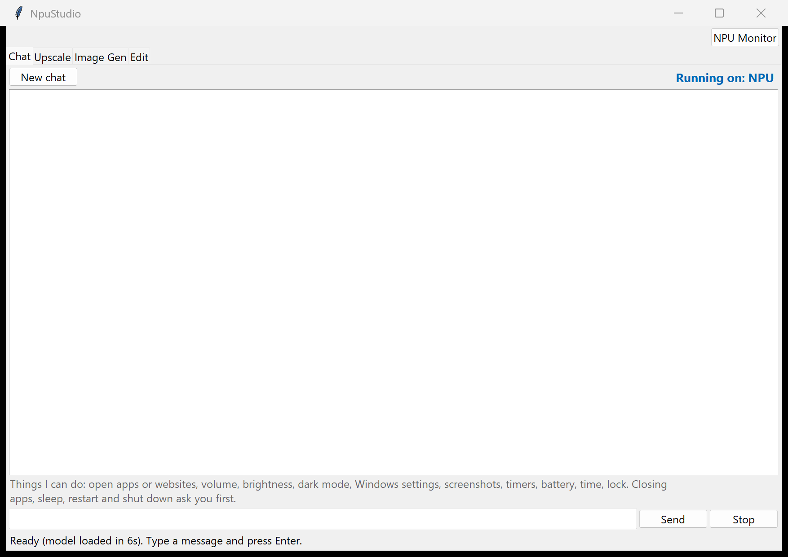
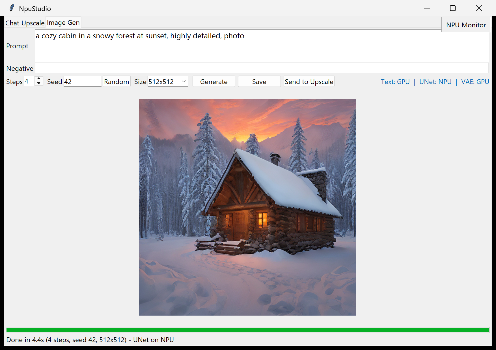
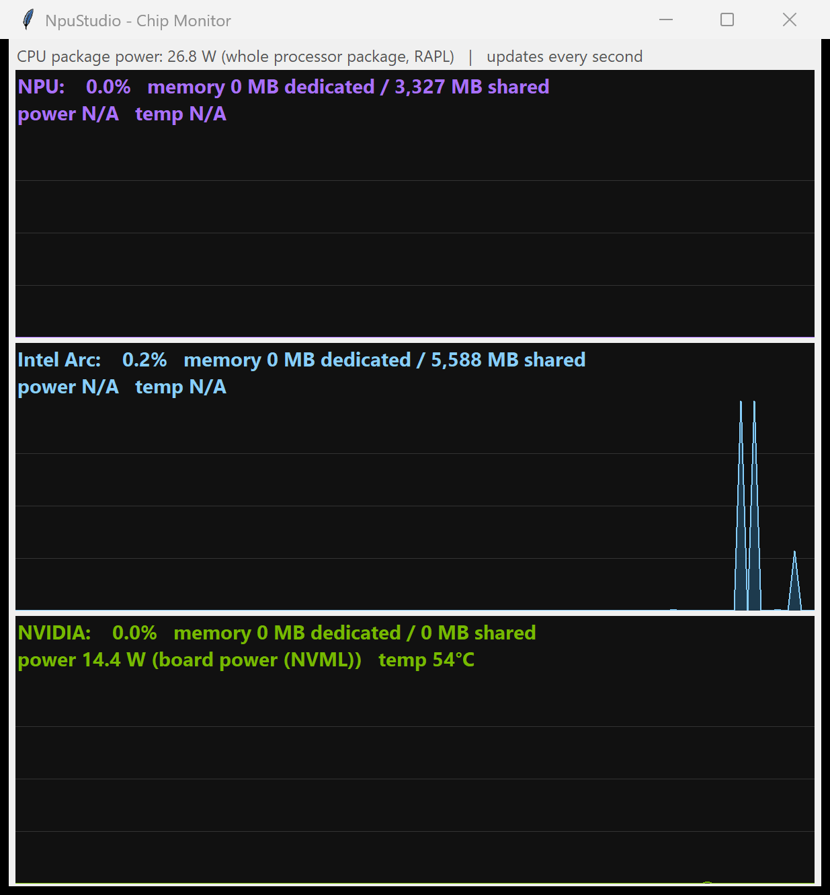

# NpuStudio

An offline AI studio for Windows laptops with an **Intel Core Ultra NPU** and **Intel Arc** graphics, with optional **NVIDIA** GPU support. Everything runs locally on your own chips — no cloud.

## Features
- **Chat** — local Phi-3.5 assistant on the NPU that can also do safe, allowlisted PC actions (open apps/sites, volume, brightness, dark mode, screenshots, timers…). Risky actions like shutdown ask first.
- **Upscale** — 2x/4x/8x/16x with a Fast (Intel SR-1032) or Sharp (Real-ESRGAN x4plus) model, memory-limit guard, zoom compare window.
- **Image Gen** — LCM Dreamshaper text-to-image, with screen-resolution presets that fit wallpapers without stretching.
- **Edit** — crop/rotate/resize, sliders and filters, AI background removal, AI erase, and an **AI Change** window that analyzes the picture, auto-selects what you name (or what you brush), then redraws it.
- **Device picker** — Auto, NPU, Intel Arc, NVIDIA, or All (split work across chips).
- **Chip Monitor** — live usage, memory, power and temperature for NPU, Arc and NVIDIA ("N/A" when a reading isn't available).

See [Features.txt](Features.txt) for the full list.

## Screenshots

## Requirements
- Windows 11, Intel Core Ultra (Meteor Lake or newer) with NPU driver installed
- 16 GB RAM minimum (32 GB recommended), ~15 GB free disk
- Optional: NVIDIA RTX GPU (adds ~4.5 GB of CUDA packages)

## Setup
1. Download or clone this repo.
2. Double-click `NpuStudio.bat`. On first run it runs `setup.ps1`, which installs Python 3.11 (via uv), OpenVINO and the models into this folder. Takes a while.
3. After that, `NpuStudio.bat` just launches the app.

## Models downloaded (not included in this repo)
Each model keeps its own license — please check the model card before using outputs commercially.

| Model | Used for | License |
|---|---|---|
| OpenVINO/Phi-3.5-mini-instruct-int4-gq-ov | Chat | MIT |
| OpenVINO/Phi-3.5-vision-instruct-int4-ov | Image analysis | MIT |
| OpenVINO/InternVL2-1B-int4-ov | Image analysis (fallback) | MIT |
| OpenVINO/LCM_Dreamshaper_v7-int8-ov | Image Gen | MIT |
| Intel single-image-super-resolution-1032 (Open Model Zoo) | Fast upscale | Apache-2.0 |
| Real-ESRGAN x4plus (xinntao) | Sharp upscale | BSD-3-Clause |
| IS-Net general-use (DIS, via rembg) | Background removal | Apache-2.0 |
| LaMa (Carve/LaMa-ONNX) | AI erase | Apache-2.0 |
| stable-diffusion-v1-5/stable-diffusion-inpainting | AI Change (redraw) | CreativeML OpenRAIL-M |
| lllyasviel/control_v11p_sd15s2_lineart_anime | AI Change (ControlNet redraw guidance) | OpenRAIL |
| Lykon/dreamshaper-8-inpainting | AI Change (redraw base model) | CreativeML OpenRAIL-M |
| lllyasviel/control_v11p_sd15_openpose | AI Change (pose redraw guidance) | OpenRAIL |
| lllyasviel/Annotators (OpenPose body/hand/face) via controlnet_aux | AI Change (pose detection) | CMU OpenPose weights: non-commercial use only |
| timbrooks/instruct-pix2pix | AI Change (recolor) | MIT |
| CIDAS/clipseg-rd64-refined | Auto-masks | Apache-2.0 |
| mattmdjaga/segformer_b2_clothes | Clothing/body parsing | see model card |
| jonathandinu/face-parsing | Face parsing | see model card |

## License
NpuStudio's own code is MIT — see [LICENSE](LICENSE). Models are licensed separately as listed above.
